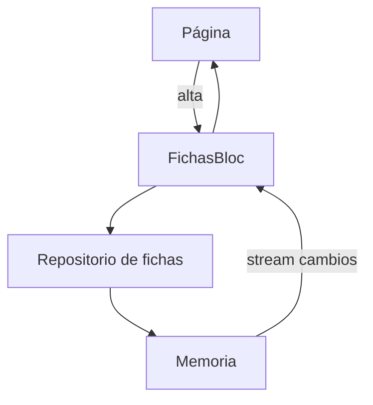

# Taller de fotos

La ficha de un trabajo del taller: título e imagen. Una ficha vacía no se guarda, y la lista llega por un stream.

## Concepto

El dominio pide título e imagen. La imagen es un puerto (`ruta` y `bytes`): en el teléfono lo llenan la cámara o la galería; en la prueba, bytes en memoria. El repositorio que existe hoy también es memoria. `get_it` lo registra, Provider lo publica en el árbol y el Bloc se suscribe al stream `cambios`. Un adaptador de Firebase colgaría de ese mismo puerto.

## Stack

| Pieza | Para qué |
| --- | --- |
| Flutter | Página y prueba de widget. |
| Imágenes | Puerto con `ruta` y `bytes`. La prueba usa bytes en memoria. |
| Clean Architecture | El dominio no importa widgets. |
| MVVM | El Bloc hace de modelo de presentación. |
| Provider | Entrega el repositorio al árbol. |
| get_it | Contenedor de inyección. |
| Bloc | `FichasBloc` reacciona al stream. |
| Streams | `cambios` avisa cada alta, sin repetir el valor inicial. |
| CRUD | Alta y listado de fichas. |

## Flujo



## Correr

Desde esta carpeta:

```bash
flutter test
flutter run
```
